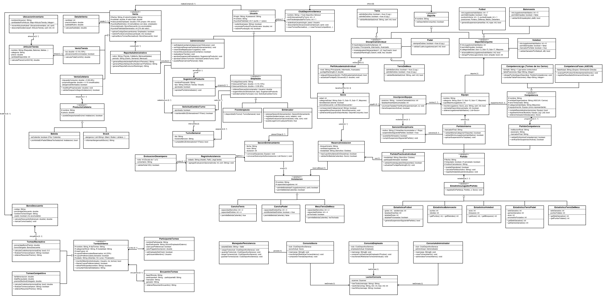

# Documento de Diseño e Implementación - Proyecto 2
## Diseño y Programación Orientada a Objetos (ISIS-1226) - Club Deportivo Séneca

Andrew Steven Avilán Rodríguez  
Laura Camila Ballén Álzate  
Universidad de los Andes  
2026

## Ajustes al Modelo de Clases y Decisiones de Diseño frente al Proyecto 1

Tomando como punto de partida la arquitectura orientada a objetos desarrollada en el Proyecto 1 para el Club Deportivo Séneca (CDS), se conservaron las jerarquías polimórficas de deportes, instalaciones, usuarios, estadísticas por partido y ventas comerciales, e introdujeron cuatro ajustes estructurales y de reglas de negocio antes de extender el modelo con el subsistema de torneos internos:

- **Equipo único representante en Competencia (`equipoInscrito`):** En la clase abstracta `Competencia` (y sus subclases `CompetenciaLiga` y `CompetenciaFases`) se reemplazó la colección previa de equipos por una asociación individual hacia un único objeto `Equipo` denominado `equipoInscrito` (`0..1`), reflejando que el club inscribe un único equipo representativo de categoría Mayores en cada competencia universitaria externa.
- **Acumulación de tarjetas amarillas entre partidos y cancelación automática de encuentros:** En `InscripcionEquipo` se incorporó el atributo `tarjetasAmarillasAcumuladas` y el método `acumularTarjetasYVerificarSuspension(int amarillas, int rojas)`, mientras que en `Partido` (`PartidoInterno` y `PartidoCompetencia`) se incorporaron los atributos `cancelado` y `motivoCancelacion`. Cuando un jugador de fútbol acumula dos tarjetas amarillas (en el mismo encuentro o sumando amarillas en partidos distintos) o recibe una roja directa, se genera automáticamente una `SancionDisciplinaria` para el siguiente partido. Si a raíz de esa suspensión el equipo no alcanza el mínimo de jugadores habilitados (7 en fútbol) o intenta alinear al jugador sancionado, el siguiente partido no puede disputarse y queda marcado automáticamente como cancelado (`isCancelado() == true`).
- **Descuento propio del empleado y puntos de fidelidad simultáneos:** Se promovió el atributo `puntosFidelidad` a la clase base `Usuario` y se ajustó `Venta` para permitir que un `Empleado` aplique en una misma compra su descuento laboral propio del 15% y la redención de sus puntos de fidelidad acumulados, además de acumular el 2% de puntos por sus compras.
- **Sincronización automática entre stock general y ubicaciones físicas de inventario:** Al registrar una `VentaTienda`, la fachada `ClubDeportivoSeneca` descuenta automáticamente las unidades vendidas primero del `Mostrador Tienda` y luego de la `Bodega Principal`, manteniendo sincronizadas las ubicaciones físicas (`UbicacionInventario`) con el stock disponible de `ArticuloTienda`.

## Diseño del Subsistema de Torneos Internos y Bonos de Descuento

- **`TorneoInterno` (abstracta):** Modela los atributos y reglas comunes de todo torneo interno (nombre, deporte, categoría o nivel requerido, modalidad, cupos máximos, día del torneo y estado). Reserva automáticamente el 20% de los cupos totales como cupos preferenciales para miembros del club, permite inscribir y retirar participantes libremente antes de iniciar, permite liberar los cupos preferenciales no llenados antes del inicio y genera el historial detallado del torneo.
- **`TorneoRecreativo`:** Subclase con inscripción gratuita (`$0`) cuyo premio al finalizar consiste en un `BonoDescuento` porcentual para la tienda del club.
- **`TorneoCompetitivo`:** Subclase con tarifa de inscripción pagada que conforma la bolsa del premio en efectivo. Valida que los empleados solo se inscriban en disciplinas individuales cuando no estén de turno el día del torneo, les cobra `$0` de inscripción y, si un empleado resulta campeón, no le entrega el premio en efectivo (`$0`).
- **`ParticipanteTorneo` y `EncuentroTorneo`:** Modelan respectivamente a cada inscrito del torneo (socio, equipo del club, empleado o externo) y cada enfrentamiento registrado por ronda con su marcador y ganador.
- **`BonoDescuento`:** Representa el bono porcentual otorgado al ganador de un torneo recreativo, aplicable en `Venta` de forma estrictamente no acumulable con otros descuentos.

## Diagrama de Clases del Diseño

## Arquitectura de Paquetes y Persistencia en Archivos

El proyecto se divide en los paquetes `uniandes.dpo.cds.modelo`, `uniandes.dpo.cds.persistencia`, `uniandes.dpo.cds.consola` y `uniandes.dpo.cds.pruebas`. La clase `ManejadorPersistencia` carga y guarda automáticamente diez archivos de texto en la carpeta `data/`: `deportes.txt`, `usuarios.txt`, `equipos.txt`, `instalaciones.txt`, `reservas.txt`, `tienda.txt`, `cafeteria.txt`, `turnos.txt`, `ventas.txt` y `torneos.txt`.

## Aplicaciones de Consola por Tipo de Usuario

- **`ConsolaSocio`:** Permite al socio autenticarse (`socio_mateo` / `pass123`), consultar su ficha, inscribirse en equipos, reservar instalaciones, registrar prácticas con cálculo de ELO, comprar en tienda y cafetería (incluyendo redención de bonos de torneos recreativos), inscribirse o retirarse de torneos internos y consultar su historial.
- **`ConsolaEmpleado`:** Permite a entrenadores y fisioterapeutas autenticarse (`profe_juan` / `pass123`), consultar turnos y puntos, planear entrenamientos, registrar asistencia y evaluaciones de 1 a 5, solicitar cambios de turno, sugerir productos, comprar aplicando simultáneamente su 15% de descuento propio y puntos de fidelidad, e inscribirse gratis (`$0`) en torneos individuales fuera de su turno.
- **`ConsolaAdministrador`:** Permite al administrador autenticarse (`admin` / `admin123`), gestionar equipos y partidos internos con control de cancelación por acumulación de amarillas, administrar competencias externas, gestionar ubicaciones de inventario, aprobar turnos validando el quórum mínimo, crear y administrar torneos internos y generar reportes.

## Pruebas Automatizadas en JUnit

Las clases `PruebasUnitariasModeloTest` y `PruebasIntegracionHistoriasTest` en `test/uniandes/dpo/cds/pruebas/` verifican mediante 26 pruebas automatizadas en JUnit 5 todas las reglas de negocio del modelo y todas las historias de usuario de extremo a extremo.

## Anexo: Declaración de Uso de Herramientas de Inteligencia Artificial Generativa

De acuerdo con los lineamientos de la Facultad de Ingeniería (Nivel 3), se declara que durante el desarrollo del Proyecto 2 se utilizó un asistente de inteligencia artificial generativa como apoyo para contrastar el modelo del Proyecto 1 con los nuevos requerimientos del enunciado, verificar la cobertura de reglas de negocio (acumulación de tarjetas amarillas entre partidos y cancelación de encuentros, equipo único por competencia externa, descuento y puntos simultáneos para empleados, sincronización de ubicaciones de inventario y reglas de torneos internos) y estructurar pruebas unitarias y de integración en JUnit 5. Todas las decisiones de diseño, el código fuente y las pruebas fueron revisados, integrados y verificados sobre el proyecto.